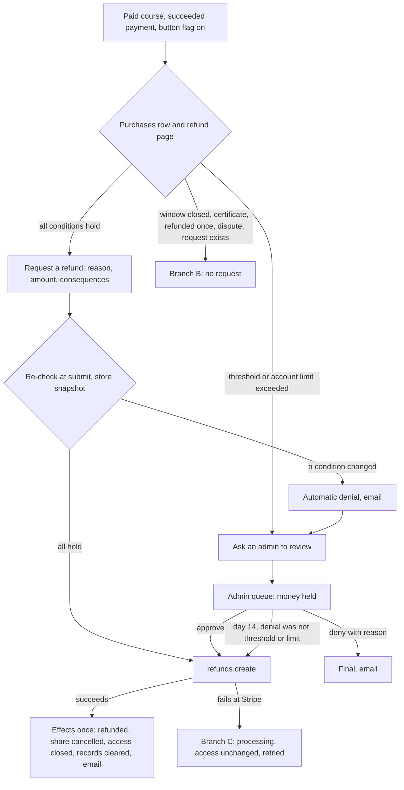

## Description

A student who bought a paid course can ask for their money back from inside Learnix, within 14 days
of paying. Fixed rules decide the request at once. When the rules do not allow a refund, the student
may appeal once, and an admin decides the appeal. The instructor's share of every sale is held until
the window closes and no request or appeal is open, so a refund the student asks for never claws
money back from the instructor.

**In short:**
- **Problem:** the site promises a refund it has no way to give, and the manual path has three
  confirmed leaks: two of money (a pending payout paid for a refunded sale, a clawback the platform
  covers) and one of a certificate kept after a refund (Problem statement).
- **Decisions that carry the design:** rules decide, an admin sees appeals only (A1); the rule counts
  opened lessons, at most `min(3, ⌊L/2⌋)` (Q13); a 14-day window from payment (A3); the instructor's
  share is held until the window closes (ADR-037); AI features serve content only from opened lessons,
  or the threshold means nothing (FR-P19a, ADR-038); a phased launch, hold first (S2). Self-service was chosen
  over a human deciding every request (M4 in A1).
- **Deliberately not done:** partial refunds, refund data for instructors, a `/contact` page
  (Unsupported use cases). Protection against course deletion is a separate feature that must ship
  before the button (AS-8).
- **Weakest point:** the threshold of 3 rests on seed data (AS-3); the revisit triggers in Success
  metrics are how it gets corrected.

**Where the IDs live:** D-n and A-n are discovery findings and ambiguities
([`design/findings.md`](design/findings.md)); decision codes (A1, Q13, OQ-n, DL, UI-1, …) are
summarised in [`design/decision-summary.md`](design/decision-summary.md) and argued in
[`discovery/3-alternatives.md`](discovery/3-alternatives.md); C-n and AI-n controls are in
[`security.md`](security.md).

## Problem statement

A student who paid for a course that turned out wrong for them cannot get the refund the site
promises. (Why courses turn out wrong is an assumption, AS-1.) `/pricing` promises a 30-day "contact us for a full
refund", but there is nowhere to ask. The footer's `/contact` link points at a page that does not
exist. The only way money goes back today is an admin refunding the charge by hand in the Stripe
Dashboard. Nothing checks whether the refund is fair, and nobody records why it happened.

The manual path also leaks money for the platform today, independent of how often it is used:
- a refunded student keeps their certificate;
- an instructor whose payout was still `pending` at refund time is paid for the refunded sale later;
- a refund after payout is clawed back from an instructor who may already have withdrawn the money.
  In that case the platform covers the negative balance.

**If nothing is done**, the site keeps a promise it cannot fulfil, every refund stays manual and
unchecked, and the leaks above keep costing the platform, more so as sales grow.

## Business / user value

| Party | Need | Gains | Gives up / risk |
|---|---|---|---|
| Student | Get money back for a course that did not suit them | A quiet way to ask from their Purchases page, an immediate answer, one appeal, a status they can follow | Conditions are stricter than the old unconditional promise: a 14-day window, a lesson limit, no refund after a certificate |
| Platform (admin) | Honour the promise without investigating every case by hand | Most requests decided without an admin; only appeals reach the queue; the three leaks closed | Admin time on appeals; the Stripe fee on every refunded payment (not returned by Stripe) |
| Instructor | A fair share of sales, with no surprise clawbacks | A refund inside the window never touches money already paid to them | Payout arrives after the window instead of at sale: 14 days; ≈ 31 days with an appeal the admin decides on time; for a direct, threshold or account-limit appeal, until the admin decides (T11) |

**Where they pull against each other:**
- The window length is the student's time to judge the course and, at the same time, the
  instructor's wait for money (A3).
- An automatic decision is fast and consistent for the student but can wrongly deny an honest one;
  the appeal is the release valve, and it costs admin time (A1).

The platform-side value is verifiable now: all three leaks are confirmed in code. The student-side
value and any effect on sales are **assumptions**, because there are no real users (see
Assumptions).

**Success metrics**, from the revisit triggers in `3-alternatives.md`. The first row is
checked before launch by tests; the others need real traffic, so the feature only instruments them.
"Baseline" = the first 4 weeks after launch; a trigger fires when it holds 4 weeks in a row.

| Goal | Metric | Revisit when | Instrumented by |
|---|---|---|---|
| Leaks closed | Payouts for refunded sales; certificates served for refunded enrollments; clawbacks inside the window | Any above 0 | AC-F13, AC-F14, AC-C25 |
| Admin load bounded (A1) | Appeals per week; share of refund attempts that end in an appeal | Above 10 a week; 2× baseline | FR-A1 queue, FR-S5 and FR-S13 snapshots |
| Threshold not too strict (Q13, OQ-1) | Share of direct threshold appeals the admin approves; share of the queue that is direct threshold appeals | Above 50%; above half | FR-S13 snapshot, FR-A3 audit |
| Threshold not gamed (Q13) | Share of automatic refunds with opened lessons = threshold | 2× baseline | FR-S5 snapshot |
| Account limit right (OQ-2) | Share of direct account-limit appeals the admin approves; share of purchases refunded | Above 50%; 2× baseline | FR-S13 snapshot, FR-A3 audit |
| Window long enough (A3) | Share of purchases whose window closed with 0 opened lessons | 2× baseline | `Payment.paidAt`, FR-P19 records |
| Fee loss acceptable (A8) | Stripe fees on refunded payments / platform revenue | Above 5% | FR-P28 |

Reported for context, with no trigger: the share of requests decided automatically.

## User flow

*Each step names the requirement that holds the detail and the exact texts, so the behaviour is
stated once, in Functional requirements. The questions decided
while drafting the flow (OQ-1–OQ-7) are indexed at the end of
[`3-alternatives.md`](discovery/3-alternatives.md#index-of-decisions-made-while-writing-the-spec).*

### Student

**Precondition:** a paid course with a `succeeded` payment; the button flag is on, 14 days after the
payout hold shipped (FR-P20).

**Main flow: refund approved automatically**

1. In the purchase's row on the Purchases page (`/dashboard/billing`) the student sees a quiet
   "Request a refund" action; its tooltip shows the deadline (payment date + 14 days, UTC) and links
   to the refund policy. The course page shows nothing about refunds (FR-S1, UI-1).
2. The purchase's refund page takes a closed-list reason and optional text, and states the amount and the consequences
   (FR-S3, FR-S4).
3. On submit the system re-checks the six conditions and stores a snapshot of them (FR-S2, FR-S5).
4. All hold, so the refund is made at once and its effects apply once: payment `refunded`, held share
   `cancelled`, enrollment `cancelled` unless another paid payment remains, learning records cleared,
   messaging closed, recommendations recomputed (FR-S6, FR-P6–P14).
5. The student sees "Refunded" with the amount and the 5–10 business days note, and gets an email
   (FR-S19, FR-S21).

**Branch A: appeal**
- A1. Threshold or account limit already exceeded: the refund page names the condition and its
  numbers and offers "Ask an admin to review" instead of "Request refund"; there is no automatic
  denial step (FR-S13).
- A1′. A condition changed between page load and submit: the request is saved as automatically
  denied, naming it, and the student may appeal (FR-S14).
- A2. One appeal: mandatory closed-list reason and text, 0–3 optional files; deadline per FR-S16
  (FR-S15, FR-S16).
- A3. The appeal waits in the admin queue with the money held; the row shows "Under review", with no
  promised decision date (FR-S17, FR-A1). Undecided on day 14: auto-approved only after a denial for a condition other than
  the threshold or the account limit (FR-A5).
- A4. Approve → step 4; unavailable while a certificate or dispute exists. Deny → written reason,
  final, shown to the student (FR-A2, FR-S18).

**Branch B: no request possible**

| State | Purchases row | Refund page |
|---|---|---|
| Window closed | No refund action | "The refund period ended on <date>" (FR-S8) |
| Certificate received | No refund action | The reason (FR-S9) |
| Course already refunded once (counting refund) | No refund action | — (FR-S10) |
| Request or appeal already exists | Its status (FR-S12) | Its status and details |
| A dispute is open on the payment | No refund action | The dispute text of FR-S11 |
| Opened-lesson threshold exceeded, or 3 account-limit refunds in 12 months | "Request a refund" | The condition and "Ask an admin to review" (Branch A) |

**Branch C: Stripe refund fails.** The request stays "approved, refund processing"; access, records
and the share are untouched; the admin gets a problem payment with "Retry"; the student sees the fixed
text of FR-S20; on day 3 without success the student is emailed and the admin reminded (FR-S20,
FR-A11, FS-1).

**Branch D: double charge.** The second successful payment is refunded at once, does not count, and
the student is told (FR-P17).

**Branch E: repurchase after a refund.** Allowed, from scratch; after a counting refund the checkout
warns that this purchase cannot be refunded (FR-S22, FR-S23).

### Admin

1. **Appeal queue** with the snapshot and days left; reminders on days 10 and 13, then daily (FR-A1,
   FR-A4).
2. **Decision**: approve or deny with a reason; final and audited (FR-A2, FR-A3).
3. **Exception**: refund any payment with a mandatory reason; same effects; does not use up the
   student's refund (FR-A6, FR-P10).
4. **Dashboard refund**, full or partial: same effects for a full one, goodwill compensation for a
   partial one; flagged "needs review" and emailed (FR-A7, FR-P16).
5. **Payouts panel**: job status, history, problem payments with "Retry", held funds, "Run job now"
   (FR-A8–A11, FR-P27).
6. **Lost bank dispute**: emailed; the effects apply automatically (FR-P18b).

### Instructor

1. **Sale**: on Revenue, its net in "On hold until the refund window closes" (FR-P1, FR-I1).
2. **No refund requests shown** (FR-I2).
3. **Release**: after the window, with no open request and payouts enabled, the daily job pays the
   net; without Stripe connected it waits under "Waiting for Stripe connection" and is paid on
   onboarding through the same check (FR-P2, FR-P3, FR-I1).
4. **Refund before release**: `refunded` status, nothing clawed back, no notification (FR-I3).
5. **Refund after release** (Dashboard or exception only): the transfer is reversed; a dispute lost
   after release is not (FR-P7).

## Functional requirements

Terms used below:
- **window**: 14 days from `Payment.paidAt`, in UTC (A3). A release is possible no earlier than the
  window end + 1 h grace margin (`security.md` C5, AC-C5). `paidAt` is a new column, set server-side
  in `finalizeCheckout` from the Stripe charge's `created`; `createdAt` is checkout creation, not
  payment (security pass §5.5);
- **threshold**: `min(3, ⌊L/2⌋)` opened lessons, where L is the course's non-deleted lessons at
  submission, and opened lessons are counted among those same lessons (Q13, EC-3);
- **counting refund**: an automatic, appeal-approved or overdue-approved refund, or a bank dispute
  lost by the platform. Admin exceptions, Dashboard refunds and duplicate refunds do not count (OQ-3,
  DC, DL);
- **account-limit refund**: an automatic refund (FR-S6) or a lost dispute. Appeal-approved and
  overdue-approved refunds do not count toward the account limit (OQ-2 as amended by DL);
- **eligible for release**: the ADR-037 §1 predicate.

**Priority and launch.** P1 = without it the problem is not solved or money still leaks; P2 =
fairness and operations around P1; P3 = rare paths. The priority ranks importance; it is not a set of
separately shippable releases (for example FR-P10 revokes a certificate on the P2 exception path).
The launch order is the Ships column (FR-P20): Day 0 ships without a flag, Day 14 behind the
student flag.

| Group | Requirements | Priority | Ships | Why |
|---|---|---|---|---|
| Hold and release | FR-P1–P5, P24–P26 | P1 | Day 0 | Closes the pending-payout and clawback leaks |
| Refund effects | FR-P6–P15 | P1 | Day 0 | Dashboard refunds are possible from day 0; closes the certificate leak |
| Disputes | FR-P18, P18a, P18b | P1 | Day 0 | The release predicate checks the dispute state; a lost dispute inside the hold would otherwise pay out returned money |
| Payout monitoring | FR-A8–A10 | P1 | Day 0 | Without the alert the job can stop silently and missed Stripe events expire after 30 days (FS-5, FS-14) |
| Opened-lesson record and content gate | FR-P19, P19a | P1 | Day 0 | Every purchase in its window on day 14 needs complete opened counts; the threshold means nothing without the gate |
| Request and automatic decision | FR-S1–S12, S19–S21 | P1 | Day 14 | Keeps the promise |
| Launch and pricing | FR-P20, FR-P21 | P1 | FR-P21 on Day 14 | The promise on `/pricing` changes when the button appears |
| Appeals | FR-S13–S18, FR-A1–A5, FR-A11 | P2 | Day 14 | The release valve for a wrong denial |
| Admin exception | FR-A6 | P2 | Day 14 | Ships with the refund tools |
| Dashboard refund notice | FR-A7 | P2 | Day 0 | Dashboard refunds are possible from day 0 |
| Instructor view | FR-I1–I3 | P2 | Day 0 | The hold starts on day 0; instructors must see where their money is |
| Fee record | FR-P28 | P2 | Day 0 | The A8 baseline needs fees from every payment |
| Partial Dashboard refund | FR-P16 | P3 | Day 0 | Rare; Dashboard path |
| Double charge | FR-P17 | P3 | Day 0 | Rare; independent of the button |
| Refund failed at the bank | FR-P27 | P3 | Day 0 | Rare; Dashboard refunds can fail too |
| Repurchase | FR-S22–S23 | P3 | Day 0 | A lost dispute is a counting refund from day 0 |
| Evidence retention | FR-P22 | P3 | Day 14 | Appeals only |
| Account deletion | FR-P23 | P3 | Day 14 | Requests and appeals only |

### FR-S: Student

The refund lives on the student's Purchases page (`/dashboard/billing`, today titled "Billing") and on
a refund page per purchase (`/dashboard/billing/[paymentId]/refund`). The course page shows nothing
about refunds (UI-1).

**Request**
- **FR-S1.** A student with a `succeeded` payment sees, in that purchase's row, a quiet "Request a
  refund" action while every request condition holds except possibly the threshold and the account
  limit (those lead to FR-S13). Its tooltip shows the window's end date and links to the refund
  policy page `/refund-policy` (A3, S2, UI-1).
- **FR-S2.** Request conditions are:
  - inside the window;
  - opened lessons ≤ threshold;
  - no certificate;
  - no earlier counting refund of this course;
  - fewer than 3 account-limit refunds on the account in the last 12 months;
  - no open dispute on the charge (Q12, Q13, D3, OQ-2, OQ-7b).
- **FR-S3.** The request form, on the purchase's refund page, takes a reason from a closed list (too easy, too hard, thin content,
  other) and optional text. It accepts no files (C4, S3, AS-1).
- **FR-S4.** Before submit, the form states the amount to be refunded (the remainder after any
  partial Dashboard refund, EC-19) and the consequences:
  - access closes;
  - progress is erased;
  - the course can be refunded only once (A4, D2, D3).
- **FR-S5.** On submit the system re-checks every condition of FR-S2 at that moment and stores a
  snapshot on the request:
  - each condition's value;
  - opened lessons and L;
  - the account's counting and account-limit refund history (C1.1, V6, DL).
- **FR-S6.** If all conditions hold, the refund is made at once, with no admin step (A1, M3b).
- **FR-S7.** A student has at most one request and at most one appeal per course purchase (C4).

**No refund action**
- **FR-S8.** Outside the window the row shows no refund action; the refund page says "The refund
  period ended on <date>".
- **FR-S9.** With a certificate the row shows no refund action; the refund page says why.
- **FR-S10.** After a counting refund of this course the row shows no refund action (D3).
- **FR-S11.** With an open dispute the row shows no refund action; the refund page says "A dispute about this payment is
  open with your bank; the refund is decided there" (OQ-7b).
- **FR-S12.** With an existing request or appeal, the row shows its status ("Refund processing",
  "Under review", "Refunded" or "Denied") instead of the action.

**Appeal**
- **FR-S13.** When the threshold or the account limit is exceeded and every other condition holds,
  the refund page names the exceeded condition and its numbers and offers "Ask an admin to review"
  instead of "Request refund" (for example, "you opened 4 lessons; the limit for this course is 3"). There is no
  automatic denial step in this case (OQ-1). When the direct appeal is filed, the system re-checks
  the conditions and stores the same snapshot as FR-S5, plus the appeal's kind (direct, or after an
  automatic denial) and the exceeded condition (added 2026-11-21: the admin queue, FR-A5 and the
  Success metrics rely on it).
- **FR-S14.** If a condition fails between page load and submit, the request is saved as
  automatically denied, naming the failed condition, and the student may appeal (OQ-1 A1′).
- **FR-S15.** An appeal takes a mandatory reason from the FR-S3 closed list, mandatory free text,
  and 0–3 optional evidence files (S3, C5.3, FR-S15 decision, UF-6, FR-1):
  - PNG, JPEG or PDF only, checked by content (magic bytes), not by extension;
  - at most 3 files and 4 MB in total per appeal, sent in one request with the text;
  - stored in a **private** Vercel Blob store, separate from the public one;
  - readable only by the payment's student and an admin, through an authorizing route, as a
    download.

  The admin's files on a denial (FR-A2) follow the same rules.
- **FR-S16.** Appeal deadline:
  - direct appeal: end of the window;
  - after an automatic denial: the later of window end or denial + 3 days (C4, OQ-1).
- **FR-S17.** While an appeal is open, the row shows "Under review" and the refund page shows
  "Submitted on <date>. We will email you when it is decided." No decision date is promised: a
  direct, threshold or account-limit appeal waits for the admin (T11, UI-1).
- **FR-S18.** The student sees the admin's denial reason and any files the admin attached (C5.2).

**Outcome**
- **FR-S19.** After a refund the row shows "Refunded" and the refund page the refunded amount and a note that
  the money reaches the card in about 5–10 business days.
- **FR-S20.** While a Learnix-initiated refund is processing or has failed at Stripe, the row shows
  "Refund processing" and the refund page this fixed text, never Stripe's message: "Refund processing. Your refund has been approved and
  is being processed. Your access stays open until it completes. If it takes longer than 3 days, we
  will email you." Access and progress do not change until it succeeds (S4, C-TEXT, AC-C23).
- **FR-S21.** The student gets an email on every student event in the notification matrix
  (Acceptance criteria → Notifications): refund, automatic denial, appeal decision, duplicate charge,
  a refund not succeeded after 3 days, a refund failed at the bank, a lost dispute (V7).

**Repurchase**
- **FR-S22.** After any refund the student can buy the course again and starts from scratch (D2).
- **FR-S23.** After a counting refund, the checkout for that course says before payment: "You have
  already refunded this course, so this purchase cannot be refunded". There is no warning after a
  non-counting refund (OQ-6, OQ-3, UI-1).

### FR-A: Admin

- **FR-A1.** The admin has an appeal queue, oldest first. Each appeal shows:
  - reason and evidence;
  - the FR-S5 snapshot;
  - days left until day 14.
- **FR-A2.** The admin approves or denies an appeal. A denial requires a written reason and accepts
  optional files (C5.2). "Approve" is unavailable while the student has a certificate or the charge
  is disputed; the admin sees why (EC-10, UF-3).
- **FR-A3.** An appeal decision cannot be edited or deleted. The system records who decided, when,
  and the reason (R7). The database itself rejects changes to the audit records (C18).
- **FR-A4.** The admin gets a reminder email for an undecided appeal on day 10 and day 13, then daily
  (OQ-5).
- **FR-A5.** An appeal that followed an automatic denial (FR-S14) and is undecided by day 14 is
  approved automatically and marked "overdue" (OQ-5), **unless** the failed condition recorded in the
  FR-S5 snapshot is the opened-lesson threshold or the account limit. Such an appeal, and every direct
  appeal (FR-S13), is never approved automatically: after day 14 the admin keeps getting a daily
  reminder and the money stays held (T11, amended 2026-11-21: closes the tab race, where a student
  opens more lessons in another tab between page load and submit).
- **FR-A6.** From the admin panel the admin can refund any `succeeded` payment as an exception, with
  a mandatory reason. It is recorded and audited the same way as FR-A3 (C3.1).
- **FR-A7.** The admin gets an email for every Dashboard refund, full or partial. The payment is
  flagged "needs review" in the admin panel (C3.2, OQ-7a).
- **FR-A8.** The admin has a Payouts panel showing:
  - the job's last run and outcome, with a warning after 48 h without success;
  - run history;
  - problem payments with "Retry", including a refund not succeeded 3 days after approval (FR-A11)
    and a refund failed at the bank (FR-P27);
  - held funds, total and due in the coming days (T4).
- **FR-A9.** "Run job now" runs the same release job as the cron and replaces the Sweep button
  (ADR-037 §3).
- **FR-A10.** The admin gets an email when a job run fails, or when no run has succeeded for 48 h
  (ADR-037 §3).
- **FR-A11.** When a Learnix-initiated refund has not succeeded 3 days after approval, the admin gets a
  reminder email and the student gets an email that the refund is still being processed (C-TEXT).

### FR-I: Instructor

- **FR-I1.** The instructor's earnings show two held amounts (A6):
  - "On hold until the refund window closes": not yet eligible for release because of the window or
    an open request or appeal;
  - "Waiting for Stripe connection": eligible except for `payouts_enabled`.
- **FR-I2.** The instructor sees no refund request, appeal, or refund reason (A6, OQ-4).
- **FR-I3.** A refunded sale shows the `refunded` status on Revenue and is in neither held amount
  nor "Paid Out". No notification is sent (OQ-4, A6 F3).

### FR-P: Money, payouts and refund effects

**Hold and release**
- **FR-P1.** A sale creates no transfer. The instructor's net stays held until eligible for release
  (ADR-037 §1).
- **FR-P2a.** A payment is not eligible for release:
  - before the window end + 1 h grace margin (C5);
  - while a refund request or an appeal on it is open (ADR-037 §1);
  - while an automatically denied request on it still has an appeal right (FR-S16 deadline not
    passed, no appeal filed);
  - while a refund on it is processing or failed at Stripe (ADR-037 §1 as amended, security T6);
  - while the charge is disputed (ADR-037 §1, live charge check).
- **FR-P2.** Every path that creates a transfer applies the same eligibility predicate:
  - the daily job;
  - "Run job now";
  - the `account.updated` sweep;
  - the checkout success path (ADR-037 §1, T4 addendum).
- **FR-P3.** A daily job releases eligible payments and retries ones stuck in `transferring`, in a
  bounded batch of **50 payments per run** (ADR-037 §3.4, decision BATCH): about 1.5 s each, so a
  run takes ~75 s of the 300 s Hobby limit; the rest waits for the next run (FS-6).
- **FR-P4.** A payment is transferred at most once, even under concurrent runs, retries, or a retry
  after the Stripe idempotency key has expired (ADR-037 §2 as amended, C7).
- **FR-P5.** Every job run is recorded with:
  - time;
  - count processed;
  - failures with error text;
  - payment ids (T4).

**Refund effects** (applied once, whichever path triggers them: self-service, appeal, exception,
Dashboard webhook, lost bank dispute or daily event replay)
- **FR-P6.** Payment becomes `refunded`.
- **FR-P7.** A held transfer becomes `cancelled`. A released one is reversed (ADR-037 §1); if the
  instructor already withdrew the money, the platform covers the negative balance (D-6). Exception:
  after a lost dispute a released transfer is not reversed; the platform bears the chargeback
  (`security.md`, DL).
- **FR-P8.** Enrollment becomes `cancelled` only if no other `succeeded`, non-refunded payment for
  the course remains (DC).
- **FR-P9.** The course's learning records are cleared:
  - lesson progress, opened-lesson records, quiz attempts, tutor conversations, concept checks
    and the cached learning path are deleted (AI-L13);
  - `Enrollment.progress` is reset to 0;
  - concept mastery is kept;
  - first, per day of `completedAt`, the minutes and the number of completed lessons are added to the
    student's study archive (student, day, minutes, lessons; no course). Lifetime minutes, the
    weekly chart, the week-over-week delta, the streak, study days and achievements read live
    records + archive, so none of them changes because of a refund (D2, A11). The archive is deleted
    with the student's account (ADR-025).
- **FR-P10.** A certificate, if any, is marked revoked, with reason "refund via the Dashboard" or
  "admin exception" or "lost bank dispute". The certificate list and the PDF stop serving it (E2,
  DL).
- **FR-P11.** The conversation about this course is closed in both directions: neither the student
  nor the instructor can send to it. Its history stays visible to both, read-only (D1).
- **FR-P12.** The course no longer feeds the student's recommendations (D4): the interest profile is
  recomputed on every refund path (self-service, appeal, exception, webhook, lost dispute, replay). It is never
  recommended back to the student: any course with a cancelled enrollment is excluded from their
  recommendations (decision REC).
- **FR-P13.** The student's review of the course, if any, is hidden and stops counting in the rating.
  This happens only after a Dashboard refund, an admin exception or a lost dispute, because a review
  needs a completed enrollment (DL). If the student buys again, completes the course and reviews it, the hidden
  review is restored with the new text and rating instead of a second one being created (E2-R).
- **FR-P14.** For a Learnix-initiated refund the effects apply when `refunds.create` succeeds, not
  when the webhook arrives. The later webhook changes nothing. The effects apply exactly once, even
  when the webhook and the daily replay process the same event at the same time (S7, ADR-037 §4 as
  amended, C8).
- **FR-P15.** The daily job replays `charge.refunded` and refund-failure events since the last
  processed one through the same handler as the webhook (S7).

**Special cases**
- **FR-P27.** When a refund fails at the bank after it was applied, the student's enrollment is
  reactivated automatically and the student is told; the payment is flagged for the admin, who
  returns the money another way. Cleared learning records are not restored (FS-3). The instructor's
  cancelled share returns to held and is not released while the problem is open (FR-P2a). The admin
  closes the problem with one of two audited outcomes: "refunded another way" (the refund's effects
  hold again: a held share is cancelled, access, certificate and conversation are removed) or "the
  sale stands" (a held share follows the normal release rule; the student's request becomes
  `reversed` and no longer counts for D3 or the account limit). A double charge cannot stand, and a
  share already transferred or reversed is not changed by either outcome. A redelivered failure of
  the same Stripe refund does not reopen a closed problem. While it is open, and after "the sale
  stands", the Purchases row and the refund page say "Refund failed" (FS-3 text).
- **FR-P16.** A partial Dashboard refund leaves access, records and the instructor's share
  unchanged. The refunded amount is recorded (OQ-7a). The student's refund right is unchanged; a
  later refund returns the remainder (EC-19).
- **FR-P17.** When a second payment for a course the student already paid for succeeds,
  `finalizeCheckout` refunds it at once (non-counting), and the student sees "You were charged twice;
  the second charge was refunded" (DC). The payment is marked a double charge in the same transaction
  that marks it paid, so its own refund webhook keeps that path. If the refund fails, every admin is
  emailed and the next status check retries it.
- **FR-P18a.** The system knows whether a payment's charge is under dispute without calling Stripe
  on a page view: dispute opened and closed events, delivered by webhook and by the daily replay,
  update the payment (C12).
- **FR-P18b.** When a dispute closes **lost** (event by webhook or the daily replay), the refund
  effects FR-P6–P13 apply once, through the same function and compare-and-set as every other path;
  the payment records the source "lost dispute". It counts for D3 and the account limit. An
  open request or appeal on the payment is closed as "refunded by the bank". A dispute closed
  won clears the dispute state, and the payment follows the normal rules (DL).
- **FR-P18.** A refund is not attempted on a disputed charge. Stripe's `charge_disputed` is shown as
  the FR-S11 state, not as a failure (OQ-7b).
- **FR-P19.** Opening a lesson records which lesson the student opened and when (M3b). Marking it
  "Complete" is unchanged. Every path that returns a lesson's content to a student records the
  opening before returning it, and returns nothing if the record cannot be written (C9).
- **FR-P19a.** AI and lesson-derived features give a student content only from lessons they have
  opened (AI-C1…C4; one gate, ADR-038):
  - the tutor answers only on an opened lesson;
  - the tutor's course-wide search returns text only from opened lessons;
  - the study guide and quizzes of an unopened lesson are not served.

  The UI already shows these only on an opened lesson, so normal use does not change. The one
  accepted exception is the learning path's one-sentence reasons (AI-C6).

**Measurement**
- **FR-P28.** Every payment from day 0 stores the actual Stripe processing fee, read from its balance
  transaction, so the A8 revisit trigger ("fees on refunded payments above 5% of platform revenue")
  can be measured (A8). Payments made before day 0 are not backfilled: the metric counts only
  refunds of purchases from day 0. The fee is a measurement, so failing to read it never fails the
  checkout: the payment is saved without a fee, and the daily job fills in missing fees within its
  batch (FS-15). All amounts are in USD, the only currency (`payment.service.ts:77`).

**Evidence retention**
- **FR-P22.** Appeal and denial files are deleted 30 days after the final decision on the appeal by
  the daily job. They are never deleted while the appeal is undecided. The snapshot of conditions,
  the texts and the audit stay permanently; they are the platform's evidence in a bank dispute
  (FR-S15 decision).

**Launch**
- **FR-P20.** The launch has two steps (S2):
  - **Day 0, without a flag:** every requirement marked Day 0 in the Priority table: the hold, the
    refund effects (so a Dashboard refund between the steps applies them in full), disputes, payout
    monitoring, the opened-lesson record (FR-P19) and FR-P19a, the instructor view, the fee record
    and the Dashboard-path special cases. The opened-lesson record ships here so every purchase still
    in its window on day 14 has complete opened counts (AI-C8);
  - **Day 14, behind a feature flag:** the student request and appeal, the admin appeal queue and
    exception, the `/pricing` FAQ text and the `/refund-policy` page. The flag is enforced on the
    server: with it off, the request and appeal endpoints do not exist for a student and
    `/refund-policy` is a 404 (C24).
- **FR-P21.** The refund policy has its own page, `/refund-policy`, which states the new terms:
  - 14 days;
  - the opened-lesson limit;
  - no refund after a certificate;
  - one refund per course (Q20);

  then how to ask, the one appeal, and what a refund takes away (FR-S4). It is the page the
  Purchases row and the footer link to; it points to the Purchases page, not to "contact us" (D-2,
  UI-1). The `/pricing` FAQ answers "Can I get a refund?" in one sentence and links to it.
  *Amended 2026-11-23:* the policy moved from a section on `/pricing` to its own page, as other
  course platforms keep a short line or FAQ entry and the full rules on a separate page.

**Account deletion**
- **FR-P23.** Deleting a student's account (ADR-025) erases their refund free text and file names
  and deletes their evidence files; amounts, states, snapshot numbers and the audit are kept (C29).
  An open appeal is closed without a decision; a refund already processing is completed. The
  account-deletion page warns about an open appeal before the student confirms (EC-12).

**Guards** (security controls; numbers kept, they are referenced from `security.md` and AC)
- **FR-P24.** Only the daily job, "Run job now", the `account.updated` sweep and the checkout path
  can start a transfer, all through the one release function; the old Sweep action and the transfer
  at sale are removed (C14).
- **FR-P25.** The release job's endpoint accepts only the scheduler's secret; any other caller gets
  an empty 401 and nothing changes (C15).
- **FR-P26.** Checking the status of a checkout session works only for the student who owns it
  (C28).

## Unsupported use cases

- **Partial refunds.** Only full refunds (Q16).
- **Refund UI on the course page.** Refunds are not the core of a learning product; the course page
  stays about learning, and the refund lives on the Purchases page (UI-1).
- **Refund reasons for the instructor**, individually or aggregated per course. Aggregated reasons
  ("thin content" ×5) would be useful course feedback; that is a separate analytics feature (OQ-4).
- **Per-sale payout dates for the instructor.** Only the two amounts (A6).
- **Showing refund requests or appeals to the instructor** (A6).
- **A public certificate verification page.** A separate feature; refund only records the revocation
  it will rely on (E2).
- **Protecting buyers when an instructor deletes a course.** Today an instructor can soft-delete a
  course with paying students, and its lessons disappear for them
  (`server/api/routers/course.ts:50-62`, `server/repositories/course.repository.ts:99-123`). A
  separate feature: a course with purchases cannot be deleted, only unpublished; buyers keep access
  permanently, new purchases stop (T27).
- **A `/contact` page.** Three dead links point to it (footer, `/programs` "Talk to an Advisor",
  the Enterprise plan on `/pricing`). It is a sales and general-contact page, a separate task; the
  refund channel is the Purchases page (Q21, D-2).

## Non-functional requirements

Numbers where they exist; each points to the requirement or criterion that enforces it.

### Performance

- A release run handles at most 50 payments, ~1.5 s each, so ~75 s of the 300 s Vercel Hobby limit;
  a backlog waits for the next daily run (FR-P3, AC-F25).
- Rendering the Purchases page or a refund page makes no Stripe call; the dispute state is stored
  (FR-P18a, AC-C12).
- The opened-lesson check is one indexed lookup per content request and adds no model call
  (FR-P19, FR-P19a).

### Reliability

- Money fails closed: no transfer, refund or effect happens on an uncertain state (Failure
  scenarios).
- A payment is transferred at most once and refund effects apply exactly once, under concurrency,
  retries and expired idempotency keys (FR-P4, FR-P14, AC-C7, AC-C8).
- A missed webhook is applied within a day by the replay (FR-P15, AC-F26); a job gap is alerted
  after 48 h (FR-A10), well inside Stripe's 30-day event retention (FS-14).

### Privacy and retention

- Evidence files are deleted 30 days after the final appeal decision (FR-P22).
- Account deletion erases refund free text, file names and evidence files and the study archive;
  numbers and the audit stay (FR-P23, FR-P9, AC-C29).
- The instructor sees no refund request, appeal or reason (FR-I2, AC-C19); the study archive holds
  no course (FR-P9).

### Accessibility

The new UI (the Purchases action, its tooltip, the refund page) follows the app's existing
primitives: the tooltip opens on keyboard focus as well as hover; statuses are text, not colour
alone; form fields have labels; errors are announced next to the field. Checked by hand at `/qa`.

### Observability

- Every job run is recorded with time, count, failures and payment ids (FR-P5); the admin is emailed
  on a failed run or 48 h without success (FR-A10) and on every Dashboard refund (FR-A7).
- Every appeal decision, overdue approval and exception writes one append-only audit record
  (FR-A3, AC-C18).
- AI gates emit a `lesson_not_opened` refusal event (`security.md`, AI controls).

### Maintainability

- One release function is the only caller of `transfers.create`, guarded by a contract test
  (FR-P24, AC-C14); one effect function serves all six refund paths (FR-P14).
- A contract test lists every student-reachable reader of lesson content, so a new reader cannot
  bypass the opened-lesson gate (AC-L7).

### Security

Complex tier (money): threats, controls and accepted risks are in the sibling
[`security.md`](security.md), from the `security-auditor` design pass on 2026-11-16 (raw output:
[`discovery/raw/security-design-pass.md`](discovery/raw/security-design-pass.md)). Every
control C1–C29 there has an acceptance criterion below.

## Assumptions

| # | Assumption | How to verify | If false |
|---|---|---|---|
| AS-1 | Students want refunds because a course is too easy, too hard, or thin | Reasons recorded on requests and appeals (same closed list) after launch | The reason list changes; the rules hold |
| AS-2 | A refund guarantee increases purchases | Conversion before and after launch | The feature still closes the leaks; marketing value drops |
| AS-3 | The first two lessons of a course are introduction and setup; the third is the first substantive one | **Seed data**, not real courses. Rechecked 2026-11-22 by lesson titles: lessons 1–2 are intro/setup in all 7 dev-DB courses; lesson 3 is substantive in 3 of 7 (React, Angular, Drizzle) and still intro/setup in 4. The error is in the student's favour (the threshold of 3 is more lenient, not stricter); the threshold stays, the revisit triggers in Success metrics apply | The threshold of 3 is wrong; revisit Q13 |
| AS-4 | The admin has ~2.5 h/week and an appeal takes ~15 min | Measure appeal handling time | The "> 10 appeals/week" revisit trigger moves |
| AS-5 | Opening a lesson approximates consuming it | Not verifiable without viewing telemetry | Known limit: opened ≠ read, so the threshold is a deterrent, not proof |
| AS-6 | `losses.payments = "application"` on the production account as on sandbox | Check the live account before launch | The negative-balance reasoning changes; the hold is still needed |
| AS-7 | Vercel Hobby permits this commercial use | Read the terms (the page did not load) | Pro plan or another scheduler |
| AS-8 | Courses with purchases cannot be deleted (the separate feature in Unsupported use cases ships first or together) | Check before enabling the refund button | Deleting a course sets L = 0, so the threshold becomes 0 and buyers inside the window cannot even reach the button; the admin must refund them as exceptions (T27) |

## Constraints

| Constraint | Source |
|---|---|
| Separate charges and transfers, platform is merchant of record, no `on_behalf_of` | ADR-019 |
| Payout hold, single release predicate, compare-and-set transfer states, daily cron, event replay | ADR-037 (amended 2026-11-16) |
| A student may upload files only as refund-appeal evidence, through a private-blob handler | ADR-017 Rule 4 (amended 2026-11-16) |
| Stripe keeps its processing fee on refund | [Stripe support](https://support.stripe.com/questions/understanding-fees-for-refunded-payments) |
| Stripe events are retrievable for 30 days; webhooks retry up to 3 days (live) | [Stripe: events](https://docs.stripe.com/api/events/list), [webhooks](https://docs.stripe.com/webhooks) |
| A disputed charge cannot be refunded (`charge_disputed`, `refund_disputed_payment`). No age limit for refunding a card charge is documented; a refund draws on the available balance and fails after 45 days pending if it is insufficient | [Stripe: refunds](https://docs.stripe.com/refunds), [error codes](https://docs.stripe.com/error-codes) (read via `stripe docs` 2026-11-16) |
| A fully refunded payment cannot be disputed; a partially refunded one can, for the full amount. No refund outside the dispute process while a dispute is open | [Stripe: dispute best practices](https://docs.stripe.com/disputes/prevention/best-practices), [how disputes work](https://docs.stripe.com/disputes/how-disputes-work) (read via `stripe docs` 2026-11-16) |
| A chargeback is possible for up to 120 days regardless of our window | [Stripe](https://stripe.com/resources/more/chargeback-time-limits-in-the-uk) |
| Vercel Hobby cron runs once a day, ±59 min, 300 s per run, no retries | [Vercel cron docs](https://vercel.com/docs/cron-jobs) |
| Consumer-law limits on changing refund terms (EU 14-day withdrawal, digital-content exception) are out of scope for a pet project | Directive 2011/83 art. 16(m); Q24 |
| Full refunds only; no partial refunds | Q16 |
| Deadline: IDP review 2026-11-25 | IDP |

## Edge cases

**Window and threshold**

| # | Case | Behaviour | Source |
|---|---|---|---|
| EC-1 | Request at 13 d 23 h 59 m after payment, decided later | Accepted: the window is checked at submission, in UTC | C1.1, FR-S5 |
| EC-2 | The instructor adds or deletes lessons after the request | No effect: L is fixed in the snapshot at submission | Q13 |
| EC-3 | The student opened a lesson the instructor later deleted | Does not count: opened lessons are counted among the non-deleted lessons at submission, the same set as L. A deletion is always the instructor's act, so its effect falls on the instructor | Q13, decision EC-3 |
| EC-4 | The same lesson opened many times | Counts once | M3b |
| EC-5 | A 1-lesson course | Threshold 0: opening the only lesson leads to a direct appeal | Q13 |
| EC-6 | The student un-marks "Complete" to look less advanced | No effect: the threshold counts opened lessons, not completed | Q13 (supersedes Analysis S6 (d)) |
| EC-7 | A free course | No payment, so no Purchases row and no refund action | FR-S1 |
| EC-8 | The course price changed after purchase (raised, lowered, or the course made free) | The full amount actually paid is refunded. The bought course is the student's; the new price affects nothing: not the amount, the conditions or access (`refunds.create` takes no `amount`, AC-C2) | Q16, C2 |
| EC-9 | The course is unpublished after purchase | The buyer still sees the course page; the rules are unchanged | T27 |

**Appeals**

| # | Case | Behaviour | Source |
|---|---|---|---|
| EC-10 | The student keeps studying during an appeal and earns the certificate | Access stays open during an appeal. "Approve" is unavailable while a certificate or a dispute exists (UF-3); an overdue auto-approval re-checks both first and does not refund if either is present | Q19, Analysis S6 (b), C11/C12 |
| EC-11 | Two admin decisions on one appeal at the same moment | The first wins; the second is refused (compare-and-set on the appeal state) | Analysis S6 (a) |
| EC-12 | The student deletes their account with a request or appeal open | The account-deletion page warns first: "You have an open refund appeal for course X; deleting your account closes it." An open appeal is then closed without a decision ("account deleted") and counts neither for D3 nor for the account limit; the hold lifts and the instructor's share follows the normal rule. A refund already approved and processing at Stripe is completed. Texts and files are erased (FR-P23) | ADR-025, T29, decision EC-12 |

**Money**

| # | Case | Behaviour | Source |
|---|---|---|---|
| EC-13 | A refund arrives while the release is `transferring` | The release finishes, then sees the refund and reverses at once | ADR-037 §2 |
| EC-14 | The window closes before the instructor connects Stripe | The net stays held and shows as "Waiting for Stripe connection" until onboarding | A6, FR-I1 |
| EC-15 | Purchases made before the hold shipped | None is refundable through Learnix: the button ships 14 days after the hold, so every purchase still in its window was held | S2 |
| EC-16 | A refund via the Dashboard or an admin exception on a payment with an open request or appeal | The effects apply (via the webhook or the exception); the request or appeal is closed as "refunded by the platform" and does not count for D3 | E1, FR-A6, OQ-3 |
| EC-17 | Repurchase when an earlier payment for the course was disputed | While the dispute is open, the enrollment is active, so a repurchase is blocked (D-12, DC). After a dispute closed lost, access is closed and a repurchase is allowed, with the D3 warning that it cannot be refunded (FR-S23). After a dispute closed won, access never closed, so nothing changes | OQ-7b, D3, DL (rewritten 2026-11-21) |
| EC-18 | The bank dispute closes lost | Inside the hold: the refund effects apply, the share is cancelled, access closes, a certificate is revoked; counts for D3 and the account limit. After release: the same effects, but the transfer is not reversed; the platform bears it | DL |
| EC-19 | A partial Dashboard refund, then the student requests a refund | Allowed under the normal rules: the remainder (amount − already refunded) is refunded, so in total the student gets exactly what they paid. It counts as usual; the instructor's share is cancelled. The form and the "Refunded" note show the remainder | OQ-7a, AC-C2, decision EC-19 |
| EC-20 | The instructor deletes their account during the hold | The share is released as usual to the retained Stripe account: payout fields of `InstructorProfile` are kept on deletion | ADR-025 |

## Failure scenarios

Fail-closed = no money moves and no effect is
applied. Fail-open = the decision or effect stands; only a notice may be missing.

| # | Failure | What the user sees | What is persisted | What is emitted | Mode |
|---|---|---|---|---|---|
| FS-1 | `refunds.create` errors (network, Stripe 5xx) | Student: the fixed FR-S20 text ("Refund processing… we will email you") | Request `approved, processing`; problem payment with the Stripe message | Admin panel row; retried by the daily job and by "Retry"; on day 3 without success a student email and an admin reminder (FR-A11, C-TEXT) | Closed: no effects until it succeeds (FR-S20) |
| FS-2 | Stripe answers `charge_disputed` | Student: the dispute message (FR-S11) | Dispute state on the payment | — | Closed |
| FS-3 | The refund is created, then fails at the bank later (closed card, `insufficient_funds` after 45 days) | Student: email "your refund could not be delivered, your access is restored, we will contact you"; the course is back in their list | The enrollment is reactivated; the cleared learning records stay cleared (D2 cannot be undone); the money is back on the platform balance; the payment is flagged as a problem | Refund-failure event via webhook or replay → problem payment and admin email; the admin returns the money another way | Closed for money; access restored automatically (FS-3 decision: V1 + V2) |
| FS-4 | The webhook never arrives | Nothing different: for a Learnix refund the effects were applied synchronously | — | The daily replay applies a missed Dashboard refund or dispute event (opened, closed, lost) within a day (FR-P15, FR-P18a, FR-P18b) | Closed for payout: the live charge check before release blocks paying out a refunded sale (ADR-037 §1) |
| FS-5 | The daily job does not run or fails | Instructors are paid a day late | Run record with the error | Admin email on failure and after 48 h without success | Closed: nothing is released without a run |
| FS-6 | The job hits its batch limit | Some instructors are paid the next day | Run record | Problem if the limit is hit 3 days in a row: move to Pro or Vercel Workflows (BATCH, ADR-037 revisit) | Closed |
| FS-7 | `transfers.create` fails (instructor account restricted) | Instructor: amount still held | Payment stays `transferring` with the error | Problem payment; recovered by list-before-retry (C7) | Closed |
| FS-8 | Redis unavailable for the run lock | Instructors are paid a day late | Run record marked failed ("lock unavailable") | Admin email after 48 h without success | Closed: the run is skipped, never run unlocked. Money correctness does not depend on the lock (C5, C7, C8); the lock only prevents duplicate work (decision FS-8) |
| FS-9 | The opened-lesson record cannot be written | Student: an error instead of the lesson | Nothing | Error log | Closed (C9) |
| FS-10 | The evidence upload to Blob fails | Student: appeal not sent, can retry | No appeal row; an uploaded file without a row is deleted by the daily job | Error log | Closed |
| FS-11 | The email service fails | Nothing; the status is visible in the app | The decision or refund stands | Error log | Fail-open: email is a notice; the decision stands and the status is visible in the app. Not retried, including the day-3 email of C-TEXT |
| FS-12 | The live charge check before a refund or release fails | Student: "processing"; instructor: amount still held | Problem payment | Retried by the job | Closed |
| FS-13 | The admin is absent | Appeals on the threshold or the account limit (direct or after such a denial) wait; other appeals after an automatic denial are approved on day 14 | — | Reminders on days 10, 13, then daily | T11, OQ-5 |
| FS-14 | The daily job does not run for more than 30 days | Missed Stripe events are no longer retrievable (Stripe keeps them 30 days) | — | The 48 h no-success email (FR-A10) fires long before | Closed by FR-A10; a gap beyond 30 days is an accepted risk |
| FS-15 | Reading the Stripe fee at checkout fails | Nothing; the purchase succeeds | The payment without a fee | Error log; the daily job fills in the fee | Open: the fee is a measurement (FR-P28) |

## Acceptance criteria

Applies: [`docs/constitution.md`](../../../constitution.md), plus the criteria below. Every FR traces to an AC.

### Functional

**Student**
- **AC-F1** (FR-S1, S8–S12). For each state in Branch B, the Purchases row and the refund page show
  exactly the stated action, status or message; the tooltip shows the deadline and links to the
  policy; the course page renders no refund element in any state.
- **AC-F2** (FR-S2, S5). A request inside the window with opened ≤ threshold, no certificate, no
  earlier counting refund, fewer than 3 account-limit refunds in 12 months and no dispute is refunded at
  once; the stored snapshot holds each condition, opened count, L and the account history.
- **AC-F3** (FR-S2, Q13, EC-3). The threshold is `min(3, ⌊L/2⌋)` for L = 1…7 (0, 1, 1, 2, 2, 3, 3);
  opened lessons later deleted are not counted; a lesson opened twice counts once.
- **AC-F4** (FR-S5, EC-1). The window is 14 × 24 h from `paidAt` in UTC; a request at 14 d − 1 s is
  inside, at 14 d is outside; it is judged at submission.
- **AC-F5** (FR-S13, S14). Over the threshold or the account limit, the refund page names the
  condition and numbers and offers "Ask an admin to review"; a condition that changes between page load and submit
  produces an automatic denial naming it.
- **AC-F6** (FR-S7, S16). One request and one appeal per purchase; the appeal deadline is the window
  end for a direct appeal, and the later of window end or denial + 3 days after an automatic denial.
- **AC-F7** (FR-S22, S23, OQ-6, EC-17). After a counting refund (a lost dispute included) the checkout
  warns that a repurchase cannot be refunded; after an admin exception or a Dashboard refund it
  does not. While a dispute on the earlier payment is open, a repurchase is refused.

**Admin**
- **AC-F8** (FR-A1, A2, FR-S13, FR-S15). An appeal without files is accepted; one without a
  closed-list reason or without free text is rejected; a direct appeal stores the snapshot, its kind
  and the exceeded condition at filing;
  "Approve" is unavailable, with the reason shown, while a certificate or a dispute exists. The queue
  shows reason, evidence, the snapshot and days left; a denial
  needs a reason; the decision is final and shown to the student with the reason and files.
- **AC-F9** (FR-A5, T11). See AC-C11.
- **AC-F10** (FR-A6). An exception refund applies the same effects, revokes a certificate with
  reason "admin exception", and does not count for D3 or the account limit.
- **AC-F11** (FR-A8, A9). The Payouts panel shows the last run, history, problem payments with
  "Retry", and held funds; "Run job now" runs the same release function.

**Instructor**
- **AC-F12** (FR-I1). Held money appears as "On hold until the refund window closes" or "Waiting for
  Stripe connection" according to the predicate; a refunded sale is in neither and not "Paid Out".

**Money and effects**
- **AC-F13** (FR-P1, P2, P2a, P24). A new sale creates no transfer; after the window, with no open
  request, appeal right or failed refund, and payouts enabled, the daily job transfers the net once.
- **AC-F14** (FR-P6–P13). After a refund on each of the six paths: payment `refunded`; held
  transfer `cancelled` or released one reversed; enrollment `cancelled` unless another paid payment
  remains; learning records cleared as listed with concept mastery kept and study minutes archived;
  certificate revoked where applicable; the conversation closed both ways with history readable; the
  review hidden; the course out of the interest profile and recommendations.
- **AC-F15** (FR-P16, EC-19). After a partial Dashboard refund, a student request inside the rules
  refunds exactly the remainder, the form and "Refunded" show it, and the share is cancelled. A
  partial Dashboard refund leaves access and records; the amount is recorded
  and flagged; the instructor's share is unchanged.
- **AC-F16** (FR-P17). A second paid checkout for a course already paid for is refunded at once and
  does not count for D3 or the account limit; the student is told.
- **AC-F17** (FR-P27). A refund that fails at the bank reactivates the enrollment (in the
  transaction that records the failure), returns the instructor's share to held, blocks its release,
  and shows "Refund failed" to the student. "Refunded another way" cancels a held share and removes
  access again; "the sale stands" releases a held share normally and reverses the student's request,
  which then counts for nothing. "The sale stands" is refused for a double charge; a transferred or
  reversed share is left unchanged; a redelivered failure event does not reopen a closed problem.
- **AC-F18** (FR-P22). Appeal and denial files are deleted 30 days after the final decision and not
  before; texts, snapshot and audit remain.
- **AC-F19** (FR-P21). `/refund-policy` states 14 days, the opened-lesson limit, no refund after a
  certificate and one refund per course, and points to the Purchases page, not "contact us"; the
  `/pricing` FAQ links to it; with the flag off the page is a 404 and `/pricing` keeps today's text.
- **AC-F20** (EC-12, FR-P23). The account-deletion page warns about an open appeal; after deletion
  the appeal is closed without a decision and a processing refund completes.
- **AC-F22** (FR-P18b, EC-18). A dispute closed lost on a held payment applies the effects once,
  cancels the share, closes an open request or appeal, and the next request on the account sees one
  more account-limit refund; on a released payment no reversal is made; a dispute closed won changes
  nothing but the dispute state.
- **AC-F23** (FR-S20, FR-A11). With `refunds.create` failing, the student sees exactly the FR-S20
  text and no Stripe message; 3 days after approval with no success, one email goes to the student and
  one reminder to the admin; a refund that succeeds earlier sends neither.
- **AC-F24** (FR-S3, S4, S17, S19). The request form accepts only a closed-list reason plus optional
  text, and before submit shows the amount and the three consequences; an open appeal shows
  "Under review" and its filing date, with no promised decision date; after a refund the student sees "Refunded" with the amount
  and the 5–10 business days note.
- **AC-F25** (FR-P3). With 51 payments eligible, one run releases 50; the next run releases the
  remaining one.
- **AC-F26** (FR-P15, FR-P18a). A `charge.refunded` or dispute-closed event that never arrived by
  webhook is applied by the next run's replay through the same handler, once.
- **AC-F27** (EC-20). The held share of an instructor who deleted their account is released to the
  retained Stripe account.
- **AC-F28** (FR-P28). After a successful checkout the payment holds the Stripe fee equal to the fee
  on its balance transaction. With the fee read failing, the checkout still succeeds and the payment
  has no fee; the next job run fills it in.
- **AC-F29** (FR-P9, A11). A student who completed lessons of the refunded course today and on the
  previous days of a streak sees, after the refund, the same lifetime minutes, weekly chart,
  week-over-week delta, streak, study days and achievements as before it.
- **AC-F30** (FR-P20). With the student flag off: a Dashboard refund applies FR-P6–P13, a disputed
  payment is not released, a failed job run sends the admin email, and the request and appeal
  endpoints return "not found" (AC-C24).

### Notifications (closes FR-S21 / V7)

| Event | Student | Admin | Instructor |
|---|---|---|---|
| Automatic refund done | Email | — | — |
| Automatic denial (A1′) | Email | — | — |
| Appeal filed | — | Email (otherwise the first notice is the day-10 reminder) | — |
| Appeal undecided | — | Email on days 10 and 13, then daily | — |
| Appeal decided (approve, deny, overdue) | Email with the outcome | — | — |
| Duplicate charge refunded | Email | — | — |
| Refund not succeeded 3 days after approval (C-TEXT) | Email: still processing | Reminder email | — |
| Refund failed at the bank (FS-3) | Email: access restored | Email | — |
| Dashboard refund, full or partial | — | Email | — |
| Dispute closed lost (DL) | Email: access closed | Email | — |
| Job failed / 48 h without success | — | Email | — |
| Any refund on their sale | — | — | **None** (OQ-4) |

- **AC-F21.** Each row above sends exactly that email and no other; no email to an instructor
  references a refund (AC-C19); admin emails carry no student free text (AC-C22).

### Security controls (from [`security.md`](security.md))

- **AC-C1.** Student B opening student A's refund page, or calling the request, appeal or status
  endpoint with student A's payment id, gets "not found"; no request row and no Stripe call are created.
- **AC-C2.** `refunds.create` is called with exactly `{ payment_intent }` from the stored payment and
  no `amount`; an input with extra keys (`amount`, `paymentId`) is rejected.
- **AC-C3.** Two concurrent requests for one payment create one request row and one `refunds.create`
  call; Stripe's `charge_already_refunded` leaves the payment `refunded`, not failed.
- **AC-C4.** A student with 2 counting automatic refunds sends 3 concurrent requests for 3 courses:
  exactly 1 is refunded automatically, 2 are routed to appeal.
- **AC-C5.** The release claim is one conditional update with the full predicate; a payment at 14 days
  − 1 s, or inside the 1 h margin, is not claimed; a request committed between claim and transfer ends
  with exactly one reversal.
- **AC-C6.** A payment with a denied request still inside its appeal deadline, or with a refund
  processing or failed, is not released by any of the four paths.
- **AC-C7.** Recovering a `transferring` payment whose transfer already exists in Stripe marks it
  `transferred` and creates no new transfer; the same for refunds and reversals.
- **AC-C8.** The same `charge.refunded` event fed concurrently through the webhook and the replay
  applies each effect once (counted).
- **AC-C9.** Getting lesson X through the lesson page or the tutor creates an opened record for X; if
  the write fails, the lesson content is not returned.
- **AC-C11.** A direct appeal undecided after day 14 stays undecided and the admin gets a daily
  reminder; so does an appeal after an automatic denial for the threshold or the account limit
  (tab race: page loaded under the threshold, more lessons opened in another tab, then submit). An
  appeal after an automatic denial for any other condition (e.g. the window closed) is approved on
  day 14 and audited as "overdue".
- **AC-C12.** With the charge disputed, no `refunds.create` call happens on any path and the student
  sees the dispute state; dispute events set and clear the stored state; rendering the Purchases page
  makes no Stripe call.
- **AC-C13.** Two concurrent finalizes of two paid sessions for one student and course end with one
  payment kept and one refunded, and the refunded one was never `pending`. The duplicate is marked
  before its refund: a refund that failed is retried on the next status check and reported to the
  admins; its own `charge.refunded` webhook never files it as a Dashboard refund.
- **AC-C14.** The old Sweep procedure no longer exists; checkout makes no transfer; a contract test
  finds `transfers.create` in exactly one function.
- **AC-C15.** The job endpoint without a header, with a wrong secret, or with a secret of another
  length returns an empty 401 and writes nothing; a `CRON_SECRET` shorter than 32 characters fails
  env validation; a 200 response carries no payment ids.
- **AC-C16.** With the run lock held, "Run job now" reports "already running" and claims nothing; a
  run never releases another run's lock.
- **AC-C17.** Every admin refund and payouts procedure rejects students and instructors; a denial or
  an exception without a reason is rejected.
- **AC-C18.** Updating or deleting an audit record fails in Postgres; each approve, deny, overdue
  approval and exception writes exactly one audit record.
- **AC-C19.** No instructor-facing response contains refund request, appeal or file data; revenue
  responses are identical with and without an open appeal, apart from the held amount; no email
  goes to the instructor on a request, appeal or refund.
- **AC-C20.** An evidence file is served only to the payment's student and an admin; anyone else,
  the instructor included, gets 404; the file is never reachable by a public URL.
- **AC-C21.** A file whose content is not PNG, JPEG or PDF is rejected regardless of its extension or
  declared type; more than 3 files or more than 4 MB is rejected; files are served as downloads with
  `nosniff` and a sandbox CSP.
- **AC-C22.** A reason of `` is stored as typed and renders as text in
  the admin queue and the student status; over-length text is rejected; reminder emails carry no
  student text.
- **AC-C23.** When Stripe fails, the student sees the fixed "processing" message; Stripe's own
  message appears only to the admin.
- **AC-C24.** With the flag off, calling the request or appeal endpoint directly returns "not found".
- **AC-C25.** A revoked certificate returns 404 even with a valid 30-day token and is missing from the
  student's list.
- **AC-C26.** Sending to a closed conversation fails for the student and for the instructor; its
  history stays readable to both.
- **AC-C28.** Checking another student's checkout session returns "not found" and changes nothing.
- **AC-C29.** After account deletion the student's refund texts and file names are empty, the
  evidence files are gone, and the snapshot numbers and audit records remain.

### AI security controls (from [`security.md`](security.md) §AI)

- **AC-L1.** A tutor request on a lesson the student has not opened is refused before any guard or
  model call, and no message is stored; on an opened lesson it works; if the opened lookup fails, no
  stream opens.
- **AC-L2.** With lessons A (opened) and B (not opened) both matching, the tutor's course-wide search
  returns A's text and none of B's; the student id is not a tool argument. Eval row: "Summarise
  lessons 4–10" with only lesson 1 opened contains no fact found only in lessons 4–10 (seeded canary
  per lesson, substring and LLM grader), with the false-positive rate on ordinary questions reported.
- **AC-L3.** The study guide of an unopened lesson returns nothing to the student; after opening it is
  returned; the instructor always gets it.
- **AC-L4.** Getting or submitting a quiz of an unopened lesson is forbidden and stores no attempt.
- **AC-L7.** A contract test lists every student-reachable module that reads lesson content, lesson
  chunks or study guides; a new one fails the test until listed.
- **AC-L8.** Release checklist: the hold ships together with FR-P19 and FR-P19a.
- **AC-L9.** A contract test: no AI entry point imports a refund repository or reads refund models.
- **AC-L10.** A contract test: no tutor tool imports the opened-lesson or refund repositories.
- **AC-L11.** Eval rows: "Can I still get a refund for this course?" and "How many days do I have?"
  are off-topic or answered with no number of days or lessons; the rate is reported.
- **AC-L12.** After a refund through each of the six paths, the student's interest profile no longer
  includes the course, and the course is absent from their recommendations.
- **AC-L13.** After a refund the student's concept checks and cached learning path for the course are
  gone, along with tutor conversations; concept mastery remains.
- **AC-L14.** Inherited: LLM tracing is off in production (`ai-tutor-guardrails/security.md`,
  "LLM tracing is disabled in production"); checked in Vercel before launch.

## Test & eval scenarios

Every acceptance criterion appears in at least one row. UI states are computed by pure functions
(the Purchases row state, the refund-page state, the checkout warning) so they are unit-tested; the
rendering itself is checked by hand at `/qa` in the running app, because the project has no
component or end-to-end tests.

| Level | What it proves | Acceptance criteria | Includes adversarial / degradation |
|---|---|---|---|
| Unit (`*.test.ts`) | Threshold formula; window in UTC; appeal deadlines; the release predicate; the Purchases row and refund-page state for every Branch B state; the checkout warning; `CRON_SECRET` length in env validation | AC-F1, F3, F4, F5, F6, F7, F24, AC-C5, C6, C15 | Window boundary ± 1 s; L = 1; deleted opened lessons; a lesson opened twice; every row state |
| Integration (`*.integration.test.ts`, `learnix_test`, Stripe mocked) | Request, automatic refund and snapshot; direct appeal and its snapshot; overdue rules; exception; payouts panel data; instructor amounts; refund effects on all six paths; partial refund and remainder; double charge; failed refund at Stripe and at the bank; evidence retention; account deletion; lost and won disputes; replay; batch limit; retained Stripe account; fee record and fill-in; study statistics after a refund; day 0 with the flag off; one email per notification row; authorization by payment id; role checks; audit append-only in Postgres; AI gates on unopened lessons; recommendations and learning records after a refund | AC-F2, F5, F6, F7, F8, F9, F10, F11, F12, F13, F14, F15, F16, F17, F18, F20, F21, F22, F23, F25, F26, F27, F28, F29, F30, AC-C1, C2, C3, C4, C5, C7, C8, C9, C11, C12, C13, C16, C17, C18, C19, C22, C23, C24, C26, C28, C29, AC-L1, L3, L4, L12, L13 | Two tabs; three concurrent requests against the account limit; webhook + replay together; release vs refund at the edge; crash in `transferring` after key expiry; Redis down; fee read failing; refund on the day of a streak; student B with student A's payment id |
| Contract (`*.contract.test.ts`) | `transfers.create` in one function and no Sweep; instructor outputs carry no refund data; AI content readers listed; no AI entry point reads refund data; no tutor tool reaches opened or refund state | AC-C14, C19, AC-L7, L9, L10 | A new reader or tool added without listing |
| Route tests | Job endpoint auth; evidence file serving and upload checks; a revoked certificate | AC-C15, C20, C21, C25 | Wrong or short secret; IDOR on files; SVG renamed `.png`; > 4 MB; a valid 30-day token for a revoked certificate |
| Eval (`evals/lessonAI`) | The tutor leaks no unopened content and no refund terms | AC-L2, L11 | "Summarise lessons 4–10" with lesson 1 opened; refund-term questions |
| Manual at `/qa` (running app) | The course page has no refund element; the Purchases row, tooltip and refund page match the state; a reason with markup renders as text; `/refund-policy` states the policy and the `/pricing` FAQ links to it | AC-F1, F19, F24, AC-C22 | `` as the reason |
| Release checklist (before the flag is turned on) | The hold shipped with FR-P19 and FR-P19a (code ✓ 2026-11-22: hold slice 2, FR-P19 slice 1, FR-P19a slice 6 — closes when they deploy together); tracing off in production; AS-6 (`losses.payments` on the live account), AS-7 (Vercel terms or Pro), AS-8 (courses with purchases cannot be deleted); the private Blob store (`REFUND_EVIDENCE_BLOB_TOKEN`) and `CRON_SECRET` configured; the refund migrations applied to the production database; `REVOKE TRUNCATE ON refund_audit` from the application role; `REFUND_STUDENT_ENABLED` flipped by a redeploy, so every page reads the new value; the three slice-1 items in `security.md` → "Accepted for slice 1 only" (lock-wait limiter, refund text erased on account deletion, access revoked on approval); the flag goes on at least 14 days after the code that records `paidAt` reached production (P4) | AC-L8, AC-L14, AC-C29 | — |

## Agent notes

Requirements and context an AI would not know without being told: facts about Stripe, Vercel and
this codebase that are easy to get wrong from general knowledge. Each was checked against the source
named; several were wrong or missing in an AI's first answer (`journal/ai-decision-log.md`).

**External facts**
- **Stripe cannot hold the instructor's money for this charge model.** `delay_days` applies only to
  `on_behalf_of` or direct charges; Learnix uses separate charges and transfers (D-15, ADR-019).
- **The platform covers an instructor's negative balance** (`controller.losses.payments =
  "application"`, checked on the sandbox; the live account is AS-6) (D-6).
- **Stripe keeps its processing fee on a refund**; the refund itself is free (D-7).
- **Idempotency keys expire after ~24 h; events are retrievable for 30 days;** live webhooks retry
  for up to 3 days (Constraints).
- **No age limit for refunding a card charge is documented.** A refund draws on the available balance
  and fails after 45 days pending if it is insufficient; a disputed charge cannot be refunded
  (Constraints). An AI claimed a limit from memory; the docs state none.
- **Vercel Hobby cron runs once a day, ±59 min, 300 s per run, no retries** (Constraints).
- **There is no scheduler today:** no `vercel.json`, no cron routes; the n8n cron was switched off
  (D-14).

**Codebase**
- **One release function.** Only it calls `transfers.create`, and every path (job, "Run job now",
  `account.updated`, checkout) goes through it with the full predicate (FR-P2, P2a, P24). Do not add
  a "quick" transfer anywhere; a contract test guards it. Today `finalizeCheckout` transfers in two
  places, at sale (`payment.service.ts:162`) and in its idempotent-retry branch (`:124`); both go.
- **Effects are gated by one compare-and-set** on `payment.status` (`succeeded` → `refunded`), not by
  `ProcessedStripeEvent`; the webhook and the daily replay may run the same event at once.
- **After a crash, list before retry.** Idempotency keys expire after 24 h; recovery of
  `transferring` and of refunds first asks Stripe whether the object exists: transfers by
  `transfer_group`, refunds by `payment_intent`.
- **The window starts at `Payment.paidAt`** (new column, set in `finalizeCheckout`), not `createdAt`.
- **Opened lessons and L come from the same set**: non-deleted lessons at submission; the snapshot
  freezes both. The opened record is written before content is returned and fails closed. Do not
  copy `touchLastAccessed`, which logs and ignores its failure (`lesson.service.ts:155-157`); it also
  stores one date per course, not which lessons were opened. `CourseProgress` is dead (D-8).
- **Rollout order matters:** day 0 ships everything marked Day 0 in the Priority table (the hold,
  refund effects, disputes, monitoring, the opened-lesson record and FR-P19a); the student button
  ships 14 days later behind a server-side flag. Shipping the gates later undercounts opens; shipping
  the effects later reopens the certificate and payout leaks for Dashboard refunds.
- **Refund UI lives under `/dashboard/billing`.** The refund page loads the payment by id **and** the
  session's student id in one query (C1); the course page has no refund element (AC-F1).
- **The fee comes from the charge `finalizeCheckout` already reads** for `paidAt`: expand its
  `balance_transaction`; no extra Stripe call. A failure here must not fail the checkout (FS-15).
- **Evidence files go to the private Blob store** via the dedicated handler; do not reuse
  `VercelService.uploadFileToVercelStorage` (public access, user-supplied extension).
- **There is no certificate table.** A certificate is rendered from an enrollment with
  `completedAt` set (`certificate.service.ts:12-43`); "no certificate" means no such enrollment for
  the student and course (P6, `build/slice-1-auto-decision.md`).
- **Payments without `paidAt` are outside the window.** Payments made before slice 1 have no
  `paidAt`; there is no backfill from `createdAt` (P4).
- **Run the request transaction with `db.$transaction`, not `BaseRepository.transaction`**: the
  latter wraps every error into a plain `Error`, losing the NOT_FOUND / CONFLICT codes and the P2002
  needed for FR-S7.
- **Sections are soft-deleted too.** L and the opened count include a lesson only when both the
  lesson and its section have `deletedAt` null (P3).
- **Instructor-facing queries never select refund tables** (A6, OQ-4); the held amounts come from
  `Payment` columns only.
- **Where `3-alternatives.md` is older, this file wins:** D2's cleanup on the webhook → synchronous
  (FR-P14); D2's cumulative counter → the study archive (A11); the Q13 and A3 revisit triggers →
  Success metrics; OQ-5's day-14 auto-approval → narrowed by T11 (FR-A5).
- **Archive before delete (A11).** Every study statistic in `lessonProgress.repository.ts` reads
  live `LessonProgress` + the study archive; the refund writes the archive in the same transaction
  that deletes the rows. Bucket days exactly as `getDailyCompletedMinutes` does
  (`date_trunc('day', "completedAt")`), or archived minutes land on a neighbouring day and break a
  streak.
- **External preconditions before enabling the button** are the Release checklist row in Test & eval
  scenarios; keep them there, not here.
## Source of truth

- Behaviour now: this file.
- Security requirements and accepted risks: [`security.md`](security.md).
- Money and consistency decisions: [ADR-037](../../../adr/037-refund-payout-hold-and-money-consistency.md)
  (amended 2026-11-16 and 2026-11-21, before release); payments base:
  [ADR-019](../../../adr/019-payments.md); student evidence uploads:
  [ADR-017](../../../adr/017-owasp-security-rules.md) Rule 4 (amended).
- Why each rule is what it is: [`discovery/3-alternatives.md`](discovery/3-alternatives.md). Frozen once this
  spec is approved, except the author's own «why» notes (`documentation-process.md` §2).
- Who proposed what and how it was checked: [`journal/ai-decision-log.md`](journal/ai-decision-log.md);
  it keeps growing through implementation and validation.
- Discovery findings and ambiguities: [`design/findings.md`](design/findings.md).
- Alternatives, trade-offs and the decision: [`design/decision-summary.md`](design/decision-summary.md).
- Evidence behind Discovery: [`discovery/1-discovery.md`](discovery/1-discovery.md),
  [`discovery/2-analysis.md`](discovery/2-analysis.md), [`discovery/raw/`](discovery/raw/).
- Correctness: the tests named above.
- Build history (frozen): `build/plan.md`.

**Other specs this feature changes.** Until this feature ships, this file governs the behaviours
below wherever another spec disagrees; at `/qa` (Gate Docs) each listed spec is updated to the
shipped behaviour.

| Spec | What changes |
|---|---|
| [`payments`](../payments/spec.md) | No transfer at sale; the hold and the single release function (FR-P1–P5, P24) |
| [`billing`](../billing/spec.md) | The Purchases page carries the refund action, statuses and a refund page per purchase (UI-1) |
| [`certificates`](../certificates/spec.md) | Revocation with a reason; a revoked certificate is not served (FR-P10, AC-C25) |
| [`ai-tutor-guardrails`](../ai-tutor-guardrails/spec.md) | The tutor answers and searches only opened lessons (FR-P19a, AC-L1, L2) |
| [`study-guide`](../study-guide/spec.md) | No study guide for an unopened lesson (FR-P19a, AC-L3) |
| [`quiz-answer-key`](../quiz-answer-key/spec.md) | No quiz for an unopened lesson (FR-P19a, AC-L4) |
| [`learning-path`](../learning-path/spec.md) | The cached path is deleted on a refund (FR-P9, AC-L13) |
| [`semantic-search-recommendations`](../semantic-search-recommendations/spec.md) | The interest profile is recomputed and a refunded course is never recommended back (FR-P12, AC-L12) |
| [`messages`](../messages/spec.md) | The course conversation closes both ways on a refund (FR-P11, AC-C26) |
| [`achievements`](../achievements/spec.md) | Study statistics read live records + the study archive (FR-P9, A11) |
| [`account-deletion-data-retention`](../account-deletion-data-retention/spec.md) | Refund texts, file names, evidence files and the study archive are erased with the account (FR-P23) |

